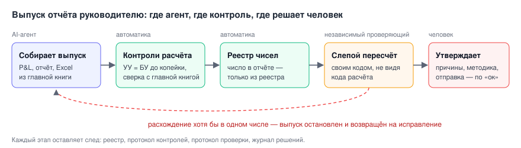

# Владимир Лобанов

**Числа для руководителя и собственника, которые можно проверить.** Финансы производства и групп компаний,
себестоимость, автоматизация финансовой функции на 1С и Power BI, работа с AI-агентами по регламенту
внутреннего контроля.

Здесь — работающие демо на вымышленных данных. Каждое можно открыть в браузере за две минуты
или запустить у себя.

## Какие риски это закрывает

| Риск собственника | Что сделано | Результат в демо |
|---|---|---|
| **Неверное число в отчёте наверх** — и доверие ко всем остальным числам потеряно | Число попадает в отчёт только из реестра, а каждый выпуск вслепую пересчитывает независимый проверяющий | В готовый отчёт внесли одну ошибку. Проверяющий нашёл именно её и подтвердил остальные 157 чисел и 495 строк реестра → [ai-management-reporting](https://github.com/till2718281828/ai-management-reporting) |
| **Управленческий отчёт расходится с бухгалтерией** | P&L строится двумя путями — управленческим и бухгалтерским, оба сверяются с главной книгой | Расхождение хотя бы на копейку останавливает выпуск → [отчёт в браузере](https://till2718281828.github.io/ai-management-reporting/) |
| **AI-агент ошибается быстро и тихо** | Работа агента идёт по регламенту: план и выдачу утверждает человек, проверяет не исполнитель, каждое решение — в журнале | Регламент и состояние всех задач — на одном экране → [claude-cycle-vscode](https://github.com/till2718281828/claude-cycle-vscode) |

Механика взята из практики — регулярного обзора для собственника группы компаний и ежемесячных
управленческих выпусков — и переписана на вымышленной компании «СтальКонструкт-Демо».

## Для AI-специалистов

| Что посмотреть | Где |
|---|---|
| Слепой агент-проверяющий: свой код пересчёта, запрет читать конвейер и тесты, протокол прогона | [`.claude/agents/blind-verifier.md`](https://github.com/till2718281828/ai-management-reporting/blob/main/.claude/agents/blind-verifier.md), [протокол](https://github.com/till2718281828/ai-management-reporting/blob/main/docs/agent-run.md) |
| Независимый скрипт-проверяющий — тест запрещает ему импортировать код расчёта | [`verifier/recompute.py`](https://github.com/till2718281828/ai-management-reporting/blob/main/verifier/recompute.py) |
| Скилл выпуска отчёта с чек-листом приёмки | [`.claude/skills/management-report/`](https://github.com/till2718281828/ai-management-reporting/tree/main/.claude/skills/management-report) |
| Цикл работы с агентом: plan mode → вопросы постановщику → план с точками остановки → исполнение по шагам → проверка субагентом с чистым контекстом (только чтение) → журнал решений | [claude-cycle-vscode](https://github.com/till2718281828/claude-cycle-vscode) |
| CI на каждом коммите: выпуск, слепая проверка, сценарий с внесённой ошибкой | [Actions](https://github.com/till2718281828/ai-management-reporting/actions) |

Стек: Python, pandas, openpyxl, pytest, GitHub Actions; Claude Code — агенты, скиллы, хуки; 1С, Power BI,
SQL — в практике.

---

**English.** Finance for manufacturing and multi-entity groups. Public demos on synthetic data: management
reporting where every number comes from a registry and each release is blind-recomputed by an independent
verifier (a planted error was caught, 157 other numbers confirmed), and an internal-control workflow for AI
agents — human-approved plans, separate reviewer, decision log.
